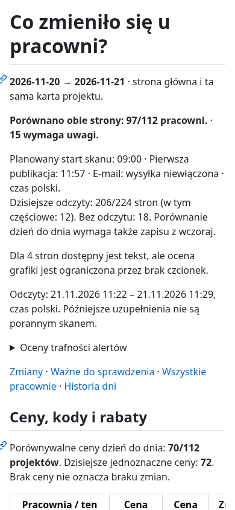
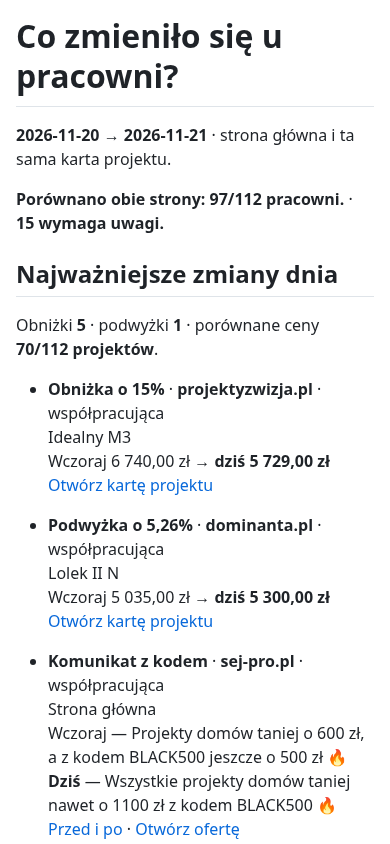

# Od alertu do dowodu zmiany

[Wnioski z przeglądu kodu i kolejność dalszych usprawnień](WNIOSKI.md)

Sprawdziliśmy porównanie z 20 i 21 listopada 2026 r. Osoba czytająca poranny raport ma rozpoznać pracownię, przeczytać, co zmieniło się dla klienta, i otworzyć zapis obu dni. [Źródłowy raport z pierwszej publikacji](https://github.com/MateuszD0/Pracownie/blob/5c1fdf28caacc9c1eacb6e06ae09f166bbd36c6d/DASHBOARD.md)

## 1. Otwarcie raportu na telefonie

W poprzednim układzie ekran 390 × 844 px kończył się na nagłówku tabeli cen. Odczyt wszystkich jej kolumn wymagał przesunięcia w bok. Tabela zajmowała 513 px przy 358 px dostępnych na treść. Przed pierwszą ceną trzeba było minąć m.in. konfigurację poczty i godziny skanu.

W nowym układzie ten sam ekran pokazuje obniżkę o 15%, podwyżkę o 5,26% i komunikat z kodem BLACK500. Wartości „wczoraj” i „dziś” zawijają się wraz z opisem. Kierunek zmiany można odczytać z tekstu. Pełne tabele nadal wymagają poziomego przewijania na wąskim ekranie.

| Przed | Po |
| --- | --- |
|  |  |

## 2. Wybór informacji na komputerze

Na ekranie 1366 × 900 px pierwsza tabela poprzednio pokazywała pojedyncze ceny. Czytelnik musiał sam policzyć obniżki i podwyżki. Zweryfikowaną zmianę komunikatu SEJ-PRO ukrywała sekcja dodatkowych zmian. Teraz na początku widać wynik dla 70 porównywalnych cen, zmianę w obu kierunkach i dwa konkretne komunikaty z linkami. Informacja o pokryciu obu stron pozostaje u góry.

[Przed zmianą na komputerze](03-before-desktop.webp) · [Po zmianie na komputerze](04-after-desktop.webp)

## 3. Otwarcie dowodu

Kliknięcie „Przed i po” przy SEJ-PRO otworzyło zdarzenie z kodem BLACK500. Wczoraj pracownia opisywała 600 zł obniżki i dodatkowe 500 zł z kodem. Dzisiaj podaje łączny rabat do 1100 zł z tym samym kodem. Oba cytaty i potwierdzenie ponownego odczytu są widoczne przed rozwinięciem zdjęć.

Po rozwinięciu przeglądarka załadowała oba zrzuty z wydania, po 717 × 891 px. W obu ujęciach okno zgody na cookies przesłania część strony. Tekst banera pozostaje widoczny na górze. Dla tego zdarzenia cytaty są czytelniejszym dowodem niż pomniejszone obrazy.

[Widok dowodu po kliknięciu](05-proof-desktop.webp) · [Zapis źródłowy z 21 listopada](https://github.com/MateuszD0/Pracownie/blob/5c1fdf28caacc9c1eacb6e06ae09f166bbd36c6d/dashboard/zdarzenia-sej-propl.md#zdarzenie-acf68e0d8fe339b7)

## Warunki sprawdzenia

Podgląd wykorzystuje plik `raporty/2026-11-21/oferty.json` z pierwszego wydania skanu `2026-11-21T102223.596488-0000-f54c218e`. Liczba 70 pochodzi z tego zapisanego pliku. Pełna przebudowa ponownie ocenia ceny na podstawie zapisów źródłowych i może zmienić liczbę porównywalnych projektów. [Archiwum źródłowe skanu](https://github.com/MateuszD0/Pracownie/releases/download/monitor-report-2026-11-21/2026-11-21-2026-11-21t102223.596488-0000-f54c218e.zip)

Porównaliśmy w Chromium treść artykułu Markdown z GitHuba i wynik nowego generatora. Publiczny serwer ze stylami interfejsu GitHuba zwracał HTTP 403, dlatego oba widoki artykułu miały identyczny lokalny arkusz stylów GitHub Markdown. Podane szerokości i położenia dotyczą tego podglądu. Test obejmował kliknięcie odnośnika i otwarcie zrzutów. Zachowanie natywnej aplikacji GitHub i czytnika ekranu pozostaje do osobnego sprawdzenia.
